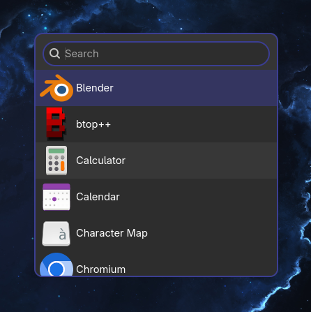

# pzs

A GTK4 Wayland-native app launcher written in Rust.



## Remote control

The app launcher can be opened via d-bus:

```sh
busctl --user call dev.peelz.pzs /dev/peelz/pzs dev.peelz.pzs.AppLauncher Toggle
```
